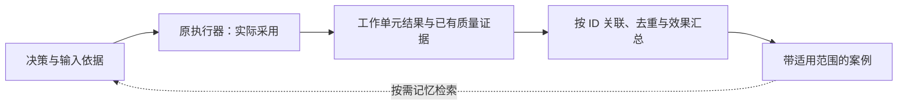

# 决策结果回收与效果验证

状态：2026-11-09 直传、SQLite 修订与原端显式补传已实现、部署并通过工程审查。真实 Mac/云端合成工程样例中，工作流选择与模型配置均已采用，共用一个结果事件，第 2 个修订与质量证据可读回，来源端待传为 0。序列化字段归[v1 合同](api-contract.md)，不是 Hindsight 原生合同。尚未证明自然业务效果；Hindsight webhook 回收仍未配置或验证。

## 0. MVP 自动回传、精确回收与效果验证

MVP 同时跑通跨 bank 判断与最小反馈闭环：服务保存决策，原 workflow/角色适配器自动回传实际采用和工作单元结果；调用者仍可补充纠正。决策与反馈先保存在本服务的 SQLite，不要求写 Hindsight，不等待前置收益证明、完整标签集或评测平台。已交付钩子通过 Herdr 的显式适配入口使用，不自动改造旧在途 runner；具体入口见[消费者说明](https://github.com/CF-FE/herdr-4-codexcloud/blob/main/docs/project-workflow-development.md#已实现入口与工程证据)。

**记录优先级：模型类型、具体型号和推理强度必须留记录，推荐与实际采用分别保存；实际配置不可读时明确未确认，模型不支持强度时记不适用。消耗计量优先级低，token、耗时等仅保存现有响应/回执可直接取得的值，缺失留缺省（字段省略或 null，含义为未提供，不是 0）。现金费用与 API 等价估价不采集、不记录。不得为补齐消耗扩展采集链路，缺消耗不阻塞 MVP、反馈接收或质量评价。**

结果按 decision_id 与原执行引用精确回收；Hindsight recall 用于复用历史案例，不能用语义搜索找全结果或计算回收率。原任务、检查点、产物和指定验收者仍拥有执行与质量事实，本服务不另做一次业务验收。

### 最小反馈合同

程序化回传只有两类，均可后续修订；人工观点或纠正保持来源标记，不因已提交就成为权威结果。

| 类型 | 何时生成 | 最少要表达的事实 |
| --- | --- | --- |
| application | 原动作/模型配置应用后核对，或确认未采用 | 推荐候选与实际动作/配置；已采用、未采用、过期、应用失败或效果未知及原因；关联原工作单元与可得执行引用 |
| result | 工作单元结束、失败或取消生效；质量结论到达时补修订 | 原执行结果、产物/质量证据引用、模型类型/型号/强度；现成 token/耗时可选附带，缺省仍是有效反馈；取消请求不冒充取消生效，技术结束与质量结论分开 |

共同记录包含：event_id、revision、kind、关联的 decision_ids、原项目/任务/工作单元及可得执行引用、observed_at、来源与内容摘要。引用复用现有记录，不虚构原生 ID：当前公共模板没有独立 run_id，可沿 project/workflow/task、source/input 摘要和原 step 关联；没有 handoff 时 action 可空，未执行时没有执行 attempt。确认未发生与引用缺失/效果 UNKNOWN 分开，不能因字段空就判未执行。角色按任务单元回收，不等退出；一执行可关联多个 decision_ids，服务每次判断有自己的 decision_id 与判断 attempt。

必要时由适配器持久保存稳定关联键并注明非原生 ID，或以已有检查点/产物记录定位；仍无法可靠区分单元/attempt 时，只确认反馈已收到，相关执行数量、用量合计和覆盖范围保留 UNKNOWN。不同 event_id 不证明发生了不同执行，不能据事件数量推算执行量。

event_id 在产生端稳定保存；同一事件、同一修订的传输重试保持 ID 和内容不变。幂等范围含经认证的产生端/项目作用域、event_id 和 revision；相同键不同内容报冲突。质量更新、更正或撤回追加新 revision 并指向被替代版本，不能被重投去重吞掉。按修订关系处理迟到/乱序，旧修订不覆盖新结论；保留原执行事实和修订依据。

usage 是可选附带数据，只接收现成用量及其已有模型、阶段、范围和来源，不要求接入新遥测或专门读日志补数。已有数据可区分单次用量/累计快照时，同快照修订替换旧值，不再次累加；原生明细按稳定引用去重，累计量不与已含明细相加。无法确认范围或合计时留缺省，不猜 token、不补零；现金费用字段不进入反馈合同。

record_decision_feedback 作为 HTTP/MCP 共用的能力接收两类程序反馈及附带来源的纠正，get_decision 可查询关联应用、结果、质量修订和回收缺口。事件修订、必要关联与接收状态在同一 SQLite 事务中持久保存后才确认收回；这不表示质量已通过。存储归属见[架构设计](architecture.md#内部存储与数据归属)，无需另建反馈总线或通用事件平台。

### 原端记录与恢复补传

1. 原调用方在应用前，把 decision_id、候选映射和原工作单元/动作关联保存在既有状态；已有决定、动作与角色记录继续作为执行依据。
2. 应用后读回实际动作/配置形成 application；工作单元终态或已有质量结论更新时形成 result。结果与待回传事件沿原检查点/回执持久保存，再尝试回传，不只在内存或角色退出时保存。
3. 网络回传失败不阻塞业务、不触发业务重跑。原恢复/后续检查点/运行结束的适配器先只读原状态，再独立调用反馈入口补传；按原记录人工查询后也可由适配器执行这一补传步骤。status/get_decision 本身保持只读，不能把发送副作用藏进查询；也不能只靠运行正常结束覆盖中途退出。
4. 若动作已发生但反馈尚未落盘，恢复时先只读原决定/动作/角色或产物记录，再补建对应事件。原 decide 可能已保存 choice/evidence 而后续 advance 报错，不能据命令失败判未采用；原 action 会随步骤推进清空，须保留原 step 关联。补传本身不调用 decide/resume 或派发命令；效果仍未知就记录未知，不能为了取得反馈重新执行。
5. 服务已收回但确认丢失时，原事件重投读回已有接收结果。产生端原检查点自身失败按原系统处理，不由网络重试绕过。

关联及恢复补传已在 Herdr 显式适配入口实现，并通过隔离验证。来源端待传事件仍归原检查点，服务 SQLite 记录已收到的反馈，不替代来源端恢复，也不能证明尚未回传的业务事实。后续适配命令或显式 reconcile 执行补传；直接运行旧 runner 不会自动补传，不存在新的定时任务、独立后台扫描器或第二套业务队列。

### 回收覆盖率与缺口

回收统计区分“反馈收到没有”和“业务是否成功”：

- **应用回收率**：已收到有效 application 的决策数 / 原集成请求中约定需要应用反馈的决策数；未采用、过期和应用失败的明确回报也算收回。普通咨询或无需执行的判断不混入分母。
- **结果回收率**：已收到有效 result 的工作单元/执行 attempt 数 / 原任务记录确认已结束且应回传的工作单元/执行 attempt 数；按执行引用去重，不按关联 decision 数膨胀。
- 原记录确认仍在执行的单元列 pending；确认已结束但未收到结果列 missing；无法确定原端状态列 UNKNOWN，并保留最后观察时间及逾期提示。缺回传不等于失败、未采用或尚在执行。
- 结果已收回但质量尚未确定，另列质量待补；后续质量修订不新增一次结果计数。

分母和终态范围来自原任务/检查点清单及恢复、结束或查询时的对账，不能只用已收到的 result 当分母。原端覆盖不足时明确可观测范围与未知终态数量；不能以局部 100% 宣称全部结果已找全。MVP 复用原状态入口做必要对账，不先建全库扫描。

### 效果怎样判断

| 层次 | 依据 | 能得出的结论 |
| --- | --- | --- |
| 采用 | 原决定、动作或真实角色配置读回 | 是否实际采用；推荐与 effective 值是否一致 |
| 执行与质量 | 原检查点、产物、已有测试/检查或指定验收者结论 | 工作单元是否结束、结果是否合格、质量是否待定；无需新增逐决策人工验收 |
| 效率 | 同一工作单元的调用、token、耗时、等待、重试和返工 | 观察该路径实际消耗；是否优于其他方式需后续可比任务或对照支持 |

工作流选择先看实际推进、阻塞解除、返工及后续质量；模型选择先看实际类型/型号/强度下的任务结果及是否升降档，有现成 token/耗时再作辅助比较。只有推荐配置实际采用的执行进入该配置的效果样本，未采用保留原因。技术步骤成功、模型配置应用成功，都不能直接作为“决策正确”标签。

同一执行可关联多个决策；已取得的执行用量按原 attempt 只计一次，服务自己的判断用量分开。保留两者关联但不把整单收益重复归给每个决策；无法分离的贡献记为联合影响/归因未知。一次失败若来自网络、权限或工具，不直接判选型错误；反事实方案未执行时不能声称它一定更差。

直接取得的 token 按已有型号与阶段分列，未覆盖部分留缺省；不要求取得判断、检索、下游执行的完整计量。已有墙钟时间不能与并发步骤时长之和混淆。先展示模型配置和质量状态，有可比消耗时再辅助比较；不把短输出或单次成功直接当作效率提升。

模型复盘按需要用于失败分析、候选解释与策略建议，不为每次结果再开一轮大模型评分，也不能独立给自身输出盖章。沿既有开发权限迭代问题、候选、检索和模型选择；普通改进不追加全面评测或逐项批准。正式效果主张仍需相应证据。

### MVP 闭环的联调范围与两侧责任

首轮以少量隔离样例或自然任务验证：实际选择/配置应用能收回 application；工作单元结果可关联读回并接受稍后的质量修订；同事件重投不产生重复反馈，有现成用量时不重复计入，恢复补传不重跑业务。可观察应用率、已知终态结果率及 pending/missing/UNKNOWN，尚无质量结论时不强行评分。消耗字段可全部缺省；联调不要求先接采集器、证明收益或建评测平台。

- **Decision Service**：保存决策，接收反馈，处理幂等/修订，提供关联查询、覆盖缺口和效果汇总。
- **Herdr/项目调用适配器**：持久绑定原执行引用，生成 application/result，记录推荐与实际模型类型/型号/强度，附带直接可得 usage，沿原恢复入口补传；不为缺失消耗另建采集适配。接入细节维护于[工作流消费者合同](https://github.com/CF-FE/herdr-4-codexcloud/blob/main/docs/project-workflow-development.md)与[角色配置合同](https://github.com/CF-FE/herdr-4-codexcloud/blob/main/docs/agent-hosts.md#decision-model-selection)。
- **原质量/验收责任方**：沿原产物检查与验收记录提供证据；本服务不新设人工评分岗位。

后续可将带来源和适用条件的案例写入获准 Hindsight 范围，供下一次决策检索。观察案例、质量证据支持的经验和策略效果结论分别标记；写入成功不提升证据等级。完整 Hindsight webhook、跨 bank 结果扫描和自动评价设施仍属下节后续能力，不是 MVP 程序化回传的前置。

## 1. 后续 Hindsight webhook 回收方案

保留“结果放对应项目 bank，decision-service 按授权读取回收”的方向，增加精确原文读取和最小确定性处理账本：

项目产生真实结果 → 标准化 outcome 写入项目 bank → 原生 retain.completed webhook → 持久 inbox → 按 bank/document ID 精确读取原文 → 校验来源与版本 → 关联原 decision → 评价账本 → 带来源的经验记录。

webhook 是通知，不是业务事实或执行许可。retain 完成只证明记忆处理阶段完成，不证明任务成功、决策正确或业务验收。项目原件继续是业务事实权威。

- 采用此回收路径的项目只需向自身 bank 发布一次结果，不默认再向决策服务双写。
- decision-service 不复制整个项目 bank；保存处理状态、必要摘要、证据引用和评价版本。
- 快速决策和异步学习分离；回收、复盘故障不阻塞原业务。
- 公共服务 bank 保存获准的可复用经验，不集中原始私有项目数据。
- 不增加新的派发器、审批平台或自动改变业务的入口。

每项业务结果选择适合原项目的发布路径，不强制 MVP 反馈再完整写一份到 bank。直传与 webhook 若并存，沿同一产生端事件/修订关联，避免重复计算；webhook 自身 event_id 只标通知，不替代原反馈事件身份。

普通经验贡献、预设和 prompt 迭代沿既有权限办理，保留来源、版本与纠正依据，不逐条增加人工审批，也不统一要求保留集、影子运行和发布评审。涉及原任务已有审批条件或扩大权限、实际执行范围的变化，仍沿原授权处理。本服务评价的是建议质量，不另做一次业务验收，原任务结果仍沿原 job、Project/Issue 和指定验收者记录回收。持久 inbox、补偿和评价账本属于有成本的后续同步能力。

## 2. 官方能力与当前适配边界

| 能力 | 官方文档口径 | 当前接入观察及设计要求 |
| --- | --- | --- |
| 原生 webhook | 按 bank 注册，支持 retain.completed / consolidation.completed；至少一次投递、签名及投递记录 | 用户确认部署支持；现有 MCP 未暴露 webhook 管理接口。注册、订阅范围、签名版本和真实回调仍待实施核验 |
| 精确文档读取 | get_document 可返回 original_text | 当前 MCP 可读取原文及文档元数据。不得用 recall 摘要代替原始 outcome |
| 文档变更 | 相同 document_id 的 retain 可替换原文 | outcome 每修订使用新 document_id；同一修订重试保留原 ID |
| 增量枚举 | Documents API 支持 tags、created_at/updated_at 时间窗口及 limit/offset | 当前 MCP 仅暴露 offset/limit/q，未暴露时间过滤、快照或持久游标；不能假装已有可靠增量同步 |
| 跨 bank | recall/retain/reflect 面向单 bank | 首版由服务逐 bank recall，范围取调用者/入口与服务可读集合的交集；模型只在其中选择相关 bank，不依赖正文授予权限 |
| 经验整理 | Knowledge Pages / Mental Models 可形成派生知识 | 可用于带来源的总结展示，不作为原始反馈账本、统计真值或验收证据 |

官方支持不等于当前版本、部署配置和 MCP 已完整暴露。启用 Hindsight webhook 回收前固定服务版本，保存脱敏合同样例，并实测签名、超时、重试上限、死信处理、文档保留和删除语义。这些不是 MVP 适配器直传的前置。

## 3. 数据归属与最小权限

- **项目 bank**：该项目的 outcome 原文、来源引用、修订与撤回说明；不改变现有项目事实系统。
- **MVP 调用与反馈记录**：保留请求、输入摘要、返回结果、来源与版本，关联 application/result、实际执行、质量修订及纠正；按第0节保存接收状态和回收缺口，不要求完整评价平台。评价不能用今天的知识冒充当时输入。
- **后续服务处理账本**：事件 ID、项目和文档绑定、revision/hash、处理阶段、重试状态、评价版本、证据引用和必要指标。它是自动回收的技术处理账本，不是授权账本。
- **服务 bank**：明确获准共享的脱敏经验与反例，附适用范围、支持证据、失效条件和版本；原项目详细评价默认留在受限账本。写回项目 bank 的评价需单独有该项目写权限。

MVP 的服务可读集合和调用者/可信入口可读集合一次静态配置，同权限受信调用者可共用配置，不逐次审批；检索范围取两者交集。默认读本项目、共享及相关项目 bank，不默认全库扫描；在此范围内可直接读其他 bank，无需复制到共享 bank 或逐条经验审批。各 bank 来源、时间与适用项目随结果保留。bank 名、tag 和 payload 中 caller_role 不能扩大配置范围，读权限不自动变成写入或删除权限。

后续启用项目结果写入或自动回收时，项目生产者原则上只写自身结果，服务另获对应写入范围。官方认证扩展不应直接等同于细粒度 bank 读写 ACL；各已启用路由检查相应权限。如同一主体需要不同 bank 的读写权限，再补足混合授权隔离或使用分别限域的身份，不把此缺口作为多 bank 只读 MVP 的前置。禁止任意 URL 抓取，证据访问也遵循有效范围。密钥、私有内容和内部地址不进入公开仓库。

### 当前网关的具体适配缺口

2026-11-08 只读核对 `create-network-sh` 的 `ebbf6d5`，以下是源码边界，不是本轮运行验证：

- [授权实现](https://github.com/ghyghoo8/create-network-sh/blob/ebbf6d5e4b8e70efc2adfb2845de26576dcfcaf1/fastmcp/hindsight-memory/server.py#L61)先按主体检查可写工具，再由适配层检查 bank 集合，已有多 bank 只读范围的配置能力；缺口是单主体尚不能表达“多个项目 bank 只读、服务 bank 可写”。跨 bank recall MVP 不依赖这项混合读写扩展；以后需要时可评估分别限域的读写身份，或由网关维护者扩展 bank/action 授权，不默认启用全项目宽权限。源码能力不代表本轮已核验运行配置或开通访问。
- 网关转发调用参数，没有由已认证主体构造可独立核验的 outcome 作者证明；webhook 验签和原文里的 producer_ref 都不足以证明作者。MVP 可保存调用者报告的纠正而不将其认证为业务事实；后续自动回收权威结果时再定义并验证可信发布合同。
- 固定 [MCP catalog](https://github.com/ghyghoo8/create-network-sh/blob/ebbf6d5e4b8e70efc2adfb2845de26576dcfcaf1/fastmcp/hindsight-memory/catalog.json)没有 webhook 管理工具，list_documents 仅暴露 bank_id/q/limit/offset；[HTTPS API 白名单](https://github.com/ghyghoo8/create-network-sh/blob/ebbf6d5e4b8e70efc2adfb2845de26576dcfcaf1/fastmcp/hindsight-memory/adapter.py#L13)还不包含 list_documents。后端支持 webhook 不等于现有接入已能注册、接收并可靠补偿；切换 API 也不自动补齐枚举能力。

本提案不直接改网关，不复制其身份/权限系统；实际需要哪项扩展，交对应维护者沿原仓库处理。

## 4. 结果合同与不可变修订

以下 envelope 用于后续 Hindsight webhook 回收，不要求 MVP 的直传事件先具备全部字段：

| 字段组 | 自定义字段与含义 |
| --- | --- |
| 类型 | schema_version、record_type=decision_outcome |
| 绑定 | project_id、decision_ids、outcome_id、revision、document_id，以及原工作单元/可得执行引用 |
| 来源 | producer_ref、source_refs、observed_at、published_at |
| 实际情况 | adoption（采用/未采用/未知）、executed_action、execution_outcome、business_outcome |
| 证据 | verification_method、verified_by_ref、evidence_refs、证据版本与摘要 |
| 纠正 | supersedes、retracts、correction_reason |
| 溯源 | 原决策和输入版本引用、关联业务对象及其版本 |

生产者身份由认证和项目注册映射验证，不能信任 producer_ref 自报。字段缺失、未知 schema、项目与原 decision 不一致、摘要冲突、来源不可验证均隔离待复核，不强行评分。

已有 MVP 反馈进入该路径时，outcome_id 沿原 event_id，revision 沿原修订，并保留认证产生端/项目作用域；服务把它作为同一语义反馈处理。bank/document 和 webhook 的 event_id 用于来源与投递追踪，不另制造一次业务结果。

无法保留原事件/修订和工作单元关联的接入方，在该项目/结果范围内只启用一种回收路径；不能把两路内容直接相加或仅靠文字相似认定重复。

每一修订用独立 document_id；修订不可覆盖旧原文。稳定写入操作 ID 只属于同一修订及同一内容。相同 ID 不同内容判冲突。明确摘要算法、规范化字节编码和计算对象；不要假设 webhook 自带业务 revision 或内容摘要，也不要混淆服务 content_hash 与自定义 outcome 摘要。若原件已被替换或无法恢复对应版本，标记证据不足，不用最新原文评价旧事件。

以上是本服务/生产者的拟议约束，当前网关没有内容 hash 级幂等保障。UNKNOWN/处理中查询原 operation；已确认失败的操作重放同 UUID 仍返回旧操作。需重新提取时沿既有授权与预算创建关联旧操作的新尝试，保留同一修订的文档和内容，不把新尝试称为原操作恢复；具体状态边界见[写回闭环](hindsight-integration.md#写回闭环)。

业务结果可先 pending，后追加最终修订；迟到结果按原 decision 关联，不因超过评估窗口而默默丢弃。

## 5. Hindsight webhook 接收、幂等与恢复

1. 接收原始请求字节，按部署实际官方签名合同验签；校验订阅 bank、事件类型、大小和格式。签名仅证明投递来源，不能证明 outcome 作者或业务真实性。
2. 持久化 inbox 和去重标识后才返回成功；存储失败不返回成功。业务评价异步执行。
3. 使用 event_id 去重投递，再用 bank + document_id + revision + 内容摘要去重语义处理。相同键摘要不一致报警隔离。
4. 精确 get_document，验证 original_text、schema、身份、项目绑定及来源。事件正文、原文和来源均为不可信数据，禁止执行其中指令。
5. 关联原 decision 快照，以事务或唯一约束落评价版本和处理状态，避免崩溃后重复计数。完成记忆读取不等于评价完成。
6. 网络错误有界退避；结果不确定先查询原 ID。永久错误进入待处理队列，不无限重试、不新建业务 ID。官方投递重试耗尽后仍需本地恢复。
7. 周期性补偿扫描找漏件，再与账本对账。仅在完整处理该扫描窗口后推进水位；重叠窗口、稳定去重及定期全量复核共同处理迟到和乱序。

扫描不能用语义 recall 或 q 搜索充当“所有新增结果”。官方时间窗口配合 offset 也不保证并发更新下的快照一致性；q 的结果数量限制不能证明全量覆盖。当前 MCP 未暴露时间过滤时，只能明确标注有限枚举边界，或在后续获准适配中增加官方 Documents API 能力。不得宣称已有可靠游标。

若部署的 webhook 或枚举合同不足以保证恢复，可评审项目发布端的持久 outbox/结果索引作为补充；它不是首选双写方案，必须明确一致性、恢复和运维成本。相关任务未实施。

## 6. 验证什么，而非让模型自证正确

完整标签协议、基线、评测和校准用于使用后的分析与改进，不是 MVP 开工或普通预设/prompt 迭代的统一前置。需要量化效果时，再按场景明确标签对象、权威证据、评价主体、时间窗口与分歧处理；例如不能用被负责人纠正后的任务成功证明原路由正确。

分别记录：建议是什么、实际采用什么、执行是否成功、业务结果如何、原决策在当时信息下是否合理。不要将五者压成一个 success。

评价结论建议为 correct / incorrect / partial / pending / insufficient_evidence / confounded / not_adopted，并记录规则版本、证据、评价主体及时间。不是所有场景都有二元真值：

- 确定性可验证场景优先用规则、测试输出或权威状态。
- 需主观评估的场景使用独立人工标注或明确有权负责人核验；多人分歧保留，不自动多数表决成事实。
- 模型复盘可提供候选解释与待查点，不能独立给自身输出盖章，高风险结果不得只依赖模型评分。
- 执行失败可能来自工具或外部依赖，不一定是分类决策错；业务成功不证明该选择最优或具有因果贡献。
- 未采用分支的真实反事实通常不可观察，应标记未知；不能把未采用推断为错误。
- 无反馈不是成功，也不是失败。过期未返回标记 pending/overdue 并统计覆盖缺口。

开展量化评价时，可按项目、场景、模型及强度/配置版本统计质量、误报/漏报、abstain/review 与纠正；已有耗时/用量作为可选辅助，不统计现金费用。分母来自原判断记录及明确的适用请求集合，不能只数收到了 webhook 的文档；只在数据直接可得时补充调用量等信息，不为统计齐全扩大采集。

需要正式效果比较时，开发/校准样本用于调整 prompt、阈值和检索策略，最终保留集只在方案冻结后评估；两者按业务对象/事件链隔离，样本不足时只报告探索结果。防止近重复及未来信息泄漏、只回收成功案例或只审核低置信案例的选择偏差。标签尽量在看模型答案前形成，高置信样本同样抽检。无法还原当时记忆可见范围时，不能将当前 bank 的离线检索表现当成线上增益证明；无需为了每次普通迭代先补齐这套评测。

评价反馈不是自动训练，也不自动改配置。普通经验、预设、prompt 和策略迭代沿既有开发权限保存版本及纠正依据，不强制每次经过保留集、影子运行和发布审批。需要这些方法支持效果主张时再采用；已有发布要求或涉及权限、实际执行范围的变更仍沿原规则。本方案仅修订文档，未授权本轮更改生产配置。

## 7. 防循环、纠正与撤回

Hindsight webhook 回收只接受注册项目的 decision_outcome 类型；MVP 直传入口接收第0节的 application/result 与带来源纠正。evaluation、lesson、reflect、Knowledge Page 和服务自身回写事件不再触发新的同类 outcome 评价，使用 record_type、origin、因果关联和服务身份联合过滤，不能只靠 tag。

自动回收的纠正追加新 revision，引用 supersedes；撤回用明确 tombstone/retracts 协议，不覆写旧评价为“从未存在”。保留必要审计，并将依赖旧证据的评价与经验标为 stale/retracted，重新计算受影响统计。经验、预设与 prompt 修订沿既有权限与来源要求；原本适用发布评审的变更仍沿原路径，不为普通修订新增审批。禁止无限“评价评价”。

没有读到文档不能证明它被删除，可能是权限变化或临时故障。当前未核验原生删除事件覆盖，不能承诺 webhook 自动传播所有撤回；需要明确撤回文档与定期证据有效性检查。实际隐私删除/保留期限另按数据规则处理，审计不可作为永久保存敏感正文的理由。

## 8. 实施阶段与验收矩阵

Hindsight webhook 回收被选定后，先完成其合同、ACL、数据最小化和脱敏样本，再实现单项目影子回收；验证后才扩大该链路范围。以下不作为跨 bank MVP 与适配器直传的前置；MVP 联调见第0节。此后续链路至少验证：

- 正常 retain 完成 → 回调 → 精确读回 → 关联决策 → 可追溯评价；
- 重复/乱序/迟到事件、同 ID 不同 hash、原件被覆盖；
- 验签失败、伪造生产者、未授权跨 bank、未知 schema、缺来源；
- 收到事件但未持久化即崩溃、持久化后未评价即崩溃、评价后重投；
- 异步 retain 部分失败、原文尚不可读、超时结果未知、重试耗尽；
- 分页并发变化、扫描中断、漏事件、水位恢复及覆盖边界；
- 纠正、撤回、证据暂时不可读、权限撤销、派生经验失效；
- 自身回写不循环、高置信错误、执行失败但原判断合理、未采用与无反馈。

验收报告分别说明投递成功、原文读取、评价完成、经验发布与业务结果。不得以文档提交、webhook 可配置或一次 2xx 声称闭环上线。

## 9. 来源与备选方案

官方资料（2026-11-08 调研口径，接入时固定版本复核）：

- [Webhooks](https://hindsight.vectorize.io/developer/api/webhooks)：通知、签名、至少一次投递与恢复边界。
- [Documents](https://hindsight.vectorize.io/developer/api/documents)：原文、更新和枚举合同。
- [Bank strategy](https://hindsight.vectorize.io/blog/2026/07/16/bank-strategy-agent-memory)：单 bank 操作与应用侧编排。
- [Knowledge Pages](https://hindsight.vectorize.io/developer/knowledge-pages) / [Mental Models](https://hindsight.vectorize.io/developer/api/mental-models)：派生知识与整理，不是业务事实账本。
- [Decision Models](https://hindsight.vectorize.io/developer/decision-models)：Hindsight 内部记忆决策能力，不等于业务真值或 OpenAI Decisions API。
- [Claims IQ](https://hindsight.vectorize.io/cookbook/applications/claims-iq)：先核验实际结果再沉淀反馈的应用模式。
- [Extensions](https://hindsight.vectorize.io/developer/extensions)：认证/验证扩展需结合具体部署验证。

比较结论：纯 recall 轮询不能保证找全结果；全部集中一个 bank 放大隐私与治理成本；一开始强制双写增加一致性问题；只依赖 webhook 无补偿会漏处理。推荐原生通知 + 精确读取 + 最小账本 + 有边界的补偿，保留项目数据归属，并把“获取结果”和“证明决策正确”拆开。
